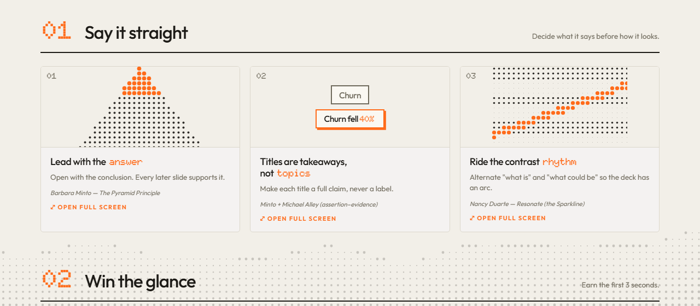

# Slide Principles

**15 research-backed rules that make a slide land, not just look good.**

A skill you import into Claude (Claude Code or Claude Design) so it builds and critiques slides the
way the best presenters do. Most slide advice is about how a slide *looks* - fonts, grids, colour,
spacing. That is the easy half. This skill covers the other half: what a slide *says*, how it gets
*seen*, how it *sticks*, how it respects the brain's *limits*, and how its data *argues*.

### See it in action

**Live, illustrated walkthrough → https://robonuggets-slide-principles.vercel.app**

Every principle has a worked example you can look at on the site.

---

## Install

Drop the `SKILL.md` into your skills folder:

- **Claude Code:** put this folder in `.claude/skills/slide-principles/` (project or user level).
- **Claude Design / Claude.ai:** add it as a skill, or paste the contents of `SKILL.md` into your
  project instructions.

Then just ask for slides. The skill runs every slide through the 5 jobs below.

**Want it animated?** Ask for motion ("animate this", "make an interactive page") and the skill
switches on an optional build guide: **CSS** for entrances and idle loops, **React + Framer Motion**
for interactive, drag-and-state animations. It only kicks in when you ask - see the *Animate the
slides* section in [`SKILL.md`](SKILL.md).

## The 5 jobs every slide must do

1. **Say it straight** - decide what it says before how it looks.
2. **Win the glance** - earn the first 3 seconds.
3. **Make it stick** - survive the look-away.
4. **Ease the load** - respect the brain's limits.
5. **Let data argue** - make the chart prove the point.

## The 15 principles

**Say it straight**
1. Lead with the answer
2. Titles are takeaways, not topics
3. Ride the contrast rhythm

**Win the glance**
4. One message per slide
5. Make one thing pop
6. Cap it at six

**Make it stick**
7. Let the picture carry it
8. Concrete beats abstract
9. Build one unforgettable beat

**Ease the load**
10. Don't put your script on the slide
11. Labels touch the thing they name
12. Empty space is working

**Let data argue**
13. Pick the chart from the message
14. Start with gray
15. One chart, one point

Full rules, the reason each one works, and how to apply it are in [`SKILL.md`](SKILL.md).

## Where it comes from

This is the message-and-cognition layer of slide design. Pair it with any visual-design rulebook
(type, grid, colour, contrast) for full coverage. Sources are the presentation and cognitive-science
canon: Barbara Minto, Nancy Duarte, Richard Mayer, John Medina, Colin Ware / Stephen Few / Cole
Knaflic, David JP Phillips, Chip & Dan Heath, Carmine Gallo, Gene Zelazny, Andrew Abela, Jon
Schwabish, Garr Reynolds, Seth Godin, Guy Kawasaki, Michael Alley.

## Made by RoboNuggets

Build and sell AI systems. Master Claude Code + Claude Design.
Join the community: https://skool.com/robonuggets

## License

[CC BY 4.0](LICENSE) - use it, remix it, ship it. Just keep the attribution.
