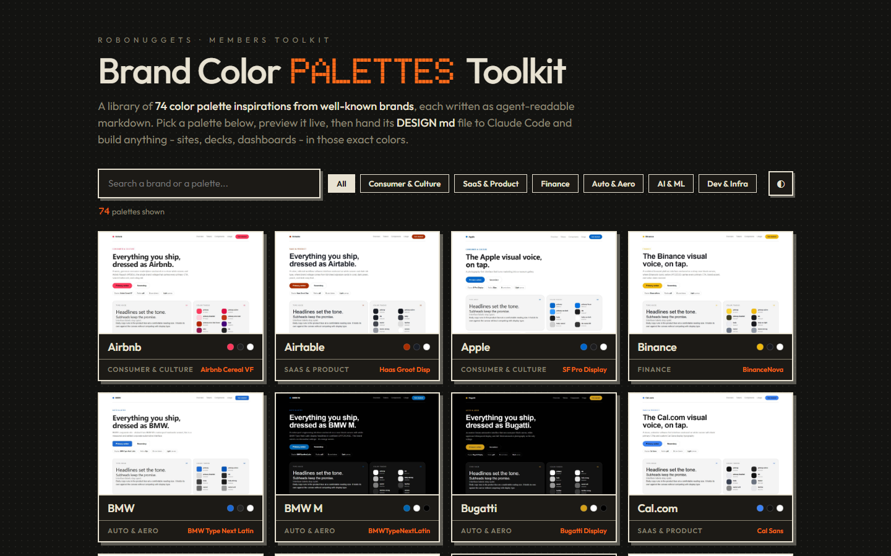

# Brand Color Palettes Toolkit

74 color palette inspirations from well-known brands, each written as agent-readable markdown. Pick a palette, preview it live, then hand its DESIGN md file to Claude Code and build anything - sites, decks, dashboards - in those exact colors.

**Live:** https://robonuggets-color-palettes-toolkit.vercel.app

Made for RoboNuggets members by Jay.

## Quick start

**1. Clone it** (your install prompt already did this):

```bash
git clone <this repo>
```

**2. Open the gallery.** This site loads its catalog with fetch, so serve it locally (double-clicking index.html won't work). Easiest: ask Claude Code -

> Serve this folder on localhost and open index.html in my browser.

Or do it manually from the folder:

```bash
npx serve .          # or: python -m http.server 8080
```

then open http://localhost:3000 (or :8080).

**3. Pick a palette, hit "Copy".** Every tile has a **Copy** button - it copies the palette's link plus a pointer to its DESIGN md in your local copy of this repo, so your agent knows exactly where the colors live. The preview page has the same button.

**4. Paste it into Claude** with whatever you're building:

> [paste] - now restyle my dashboard in these colors.

## What's included

```
index.html          The gallery - search, category chips, dark/light toggle
view.html           Live palette preview page
catalog.json        All 74 palettes with colors, category, and font metadata
systems/            74 agent-readable DESIGN md files (one per brand palette)
previews/           Live HTML preview pages
assets/thumbs/      Gallery thumbnails
vercel.json         Static deploy config
```

## Features

- 74 brand palettes across tech, luxury, automotive, finance, consumer and more
- Each palette is a small markdown file an AI agent can read and apply directly
- Live preview per palette - see the colors working before you commit
- Search + category filters, dark/light theme (persisted)

## Usage examples

- "Read `systems/apple.md` and restyle my dashboard in this palette."
- "Compare the palettes in `systems/bmw.md` and `systems/bugatti.md` and pick one for my agency site."
- "Build my slide deck using the colors from `systems/airbnb.md`."

## Deploy your own copy

```bash
vercel deploy --prod
```

## License

CC BY 4.0 - free to use with attribution.
