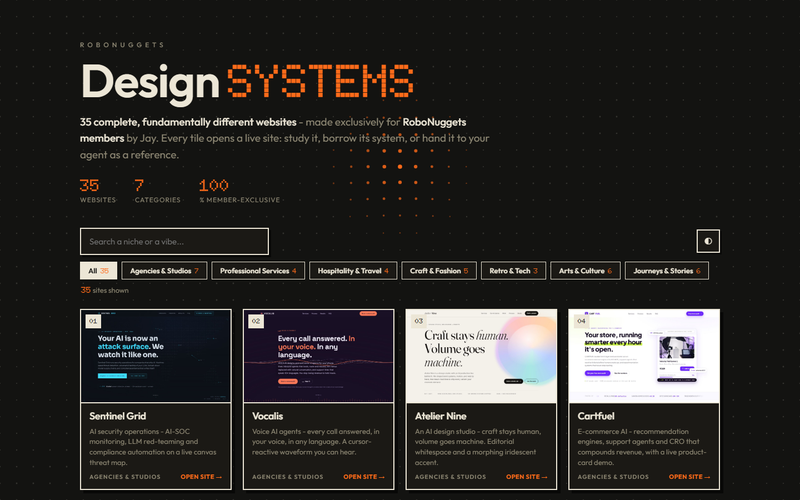

# RoboNuggets Design Systems

35 complete, fundamentally different websites - made exclusively for RoboNuggets members by Jay. Every site is a single self-contained HTML file: study it, borrow its visual system, or hand it straight to your AI agent as a design reference.

**Live:** https://robonuggets-design-systems.vercel.app

## Quick start

**1. Unzip it** - extract `robonuggets-design-systems.zip` (your agent may have done this already) and open the `design-systems` folder.

**2. Open the gallery.** Easiest: ask Claude Code -

> Serve this folder on localhost and open index.html in my browser.

Or do it manually from the folder:

```bash
npx serve .          # or: python -m http.server 8080
```

then open http://localhost:3000 (or :8080). Double-clicking `index.html` also works for this gallery.

**3. Pick a design, hit "Copy ref".** Every tile has a **Copy ref** button - it copies the design's link plus a pointer to your local copy of it (this cloned repo), so your agent knows exactly where to look.

**4. Paste it into Claude** with whatever you're building:

> [paste] - now build my landing page for my coaching business in this design.

Claude opens the reference file, extracts the palette, typography, spacing and motion, and builds YOUR content in THAT visual language.

## What's included

```
index.html              The gallery - search, categories, interactive dot-matrix background
sites/                  10 AI agency websites (security, voice, legal, health, ecom, real estate, finance, industrial, hospitality, design)
fable/                  25 "design universe" websites - every one a different visual world
assets/                 Generated photography (GPT Image 2), hero video loops (Kling 3.0), gallery thumbnails
vercel.json             Static deploy config
```

## Features

- 35 sites, no two share a style - palettes, type systems, motion languages all distinct
- Every site is one self-contained HTML file - inline CSS/JS, Google Fonts, no build step
- Advanced techniques throughout: WebGL shaders, Three.js scenes, canvas particle systems, scroll-driven animation, variable fonts, WebAudio, SVG choreography
- 7 browsable categories: Agencies & Studios, Professional Services, Hospitality & Travel, Craft & Fashion, Retro & Tech, Arts & Culture, Journeys & Stories
- Fully responsive (390 / 768 / 1440 verified), `prefers-reduced-motion` respected

## Usage examples

- "Read `fable/04-helvetia/index.html` and rebuild my landing page in this Swiss brutalist system."
- "Use `sites/pulse/index.html` as the reference for my clinic's site - same calm, same trust signals."
- "List the animation techniques used in `fable/07-abyss/index.html` and apply the scroll-depth idea to my product story."

## Deploy your own copy

```bash
vercel deploy --prod
```

## License

CC BY 4.0 - free to use with attribution.
